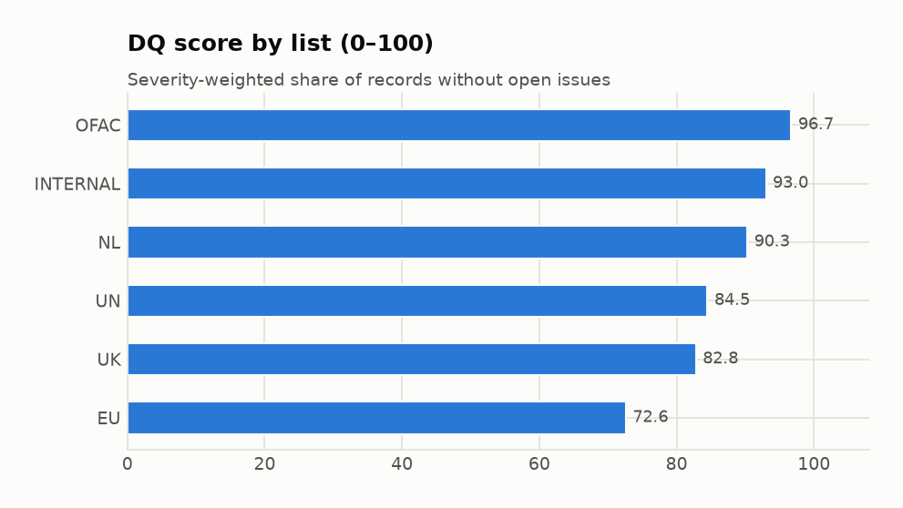
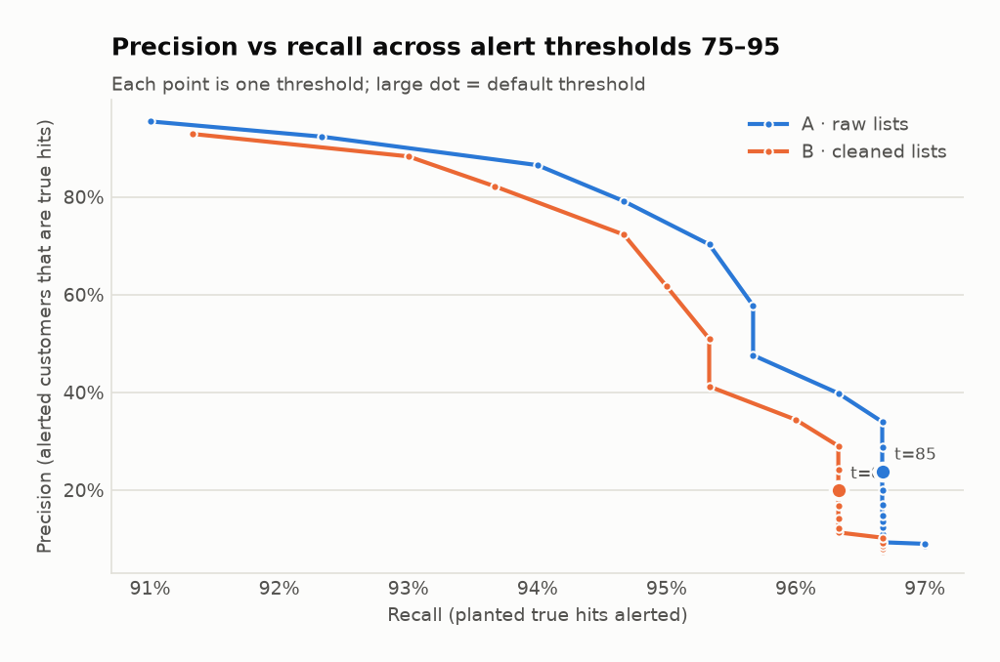
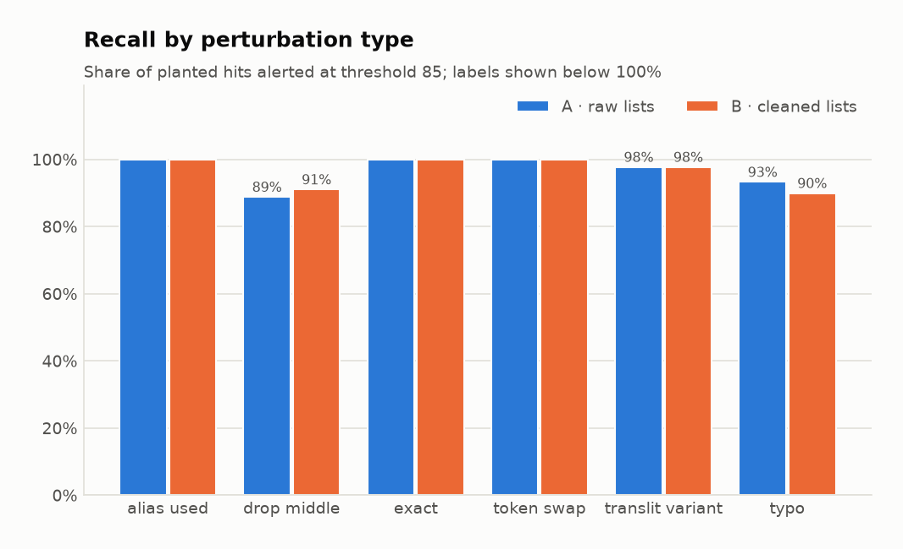
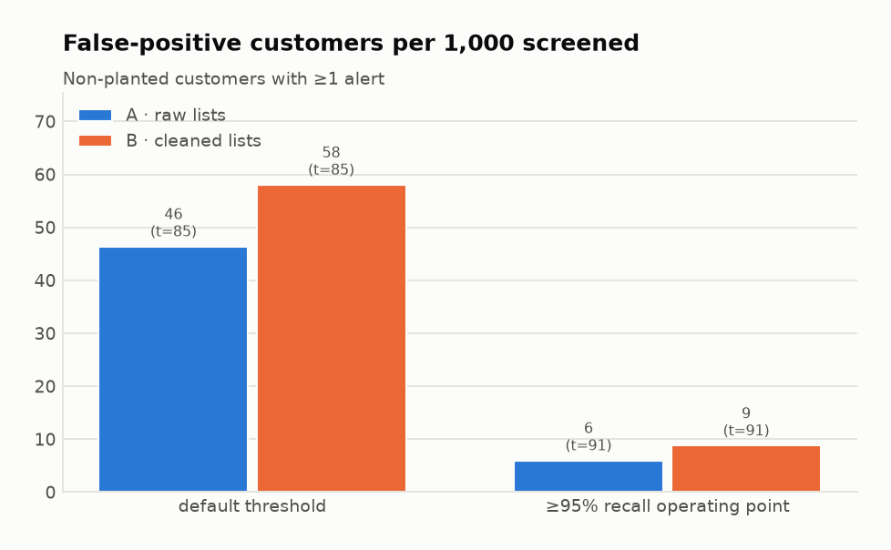

# sanctions-list-ops

**A small, working "sanctions list management" pipeline, built only from public data and free tools.**

Every day, banks have to check their customers and payments against official sanctions lists: lists of people,
companies and ships that nobody may do business with. Before any of that screening can happen, someone has to
**collect those lists, clean them, check their quality and load them into the screening systems**. That is the job
of an FEC (financial-economic-crime) *list data handler*.

This project does that job end to end, on the real lists:

1. **Downloads** five official lists every day: EU, UN, US (OFAC), UK and the Dutch national terrorism list.
2. **Converts** five different file formats into **one common table structure**.
3. **Checks data quality** with 22 rules (missing birth dates, unknown countries, duplicate passports, UN listings
   missing from the EU list, …) and **fixes** the problems that are safe to fix automatically.
4. **Works out what changed** since yesterday (added / removed / changed entries).
5. **Exports** the lists in three formats, as if feeding three different screening systems, but only if the data
   passed its quality checks (an *export gate*).
6. **Keeps an audit log** of manual list changes, where every change needs a second person to approve it
   (*four-eyes principle*).
7. **Measures the effect on screening:** it screens 20,000 fake customers, 300 of whom secretly match a sanctioned
   party, against the raw lists and then the cleaned lists, and compares how many true hits and false alarms each
   produces.
8. **Reports** everything as charts, a summary (the *Key findings* below) and an interactive dashboard.

---

## Key findings

These numbers are written automatically by the pipeline after every run. Nothing in this block is typed by hand.

<!-- FINDINGS:START -->
**Key findings, live run of 2026-11-26** (generated by `slo report`; every number comes from `data/reports/2026-11-26/summary.json`)

| List | Entities | Published | DQ score | Persons with full DOB | Persons with nationality | Open high-severity entities |
|---|---:|---|---:|---:|---:|---:|
| EU | 6,305 | 2026-11-26 | 72.6 | 72.6% | 60.3% | 914 |
| UN | 1,008 | 2026-11-26 | 84.5 | 56.9% | 85.9% | 56 |
| OFAC | 19,629 | 2026-11-23 | 96.7 | 87.3% | 81.2% | 151 |
| UK | 6,458 | 2026-11-26 | 82.8 | 68.8% | 72.3% | 744 |
| NL | 109 | 2026-11-26 | 90.3 | 100.0% | 0.0% | 0 |

- **Placeholder and partial birth dates are the biggest data gap.** 557 UK, 513 EU and 893 OFAC persons have only a year, month or range (DQ011). The UK publishes these as literal `dd/mm/YYYY` placeholders.
- **Persons with no DOB at all (DQ010):** EU 722, UK 713, UN 53, OFAC 71.
- **Country data:** 1,756 EU country fields use code `00` (UNKNOWN). OFAC/UK have 86 historical or unmappable values (e.g. `Serbia and Montenegro`, `USSR`, birth places with no country).
- **Identifiers:** 17 UK designations repeat the same passport/ID (DQ031). 173 identifiers appear on two different entities in the same list (DQ032, possible duplicates).
- **UN → EU / UK transposition:** 944 of 1,008 UN entities are found on the EU list, 1,007 on the UK list. Only 82 of those EU matches could use a UN reference published on the EU record; the rest were linked by name + DOB. 64 UN entities have no EU match (median 5752.0 days since UN listing; by UN regime: Iran 20, Guinea-Bissau 10, DPRK 7, ISIL/Al-Qaida 7).
- **Name hygiene fixed automatically:** 2,160 names with whitespace noise, 320 empty alias elements, 2,014 duplicate-name groups (DQ002/DQ004/DQ005, see `fix_log`).

**Screening experiment** (20,000 synthetic customers, 300 planted hits drawn from the lists, threshold 85):

| | Recall | Precision | FP customers / 1k | Alerts | ≥95% recall at |
|---|---:|---:|---:|---:|---|
| A · raw lists | 96.7% | 23.8% | 46.4 | 6,249 | threshold 91 (6.0 FP customers per 1k) |
| B · cleaned lists | 96.3% | 19.9% | 58.05 | 8,053 | threshold 91 (8.8 FP customers per 1k) |

Cleaning changed recall by -0.3% and false-positive customers by +11.6 per 1k at the same threshold. The weakest case after cleaning is `typo` (90% recall): dropping middle names removes most of the evidence a name matcher has. Tuned to the same ≥95% recall target, the raw lists need threshold 91 (6.0 FP customers per 1k) and the cleaned lists threshold 91 (8.8 per 1k). Comparing at one fixed threshold is misleading; list changes should be evaluated together with threshold tuning (below-the-line testing).





<!-- FINDINGS:END -->

---

## How it works (architecture in plain words)

Think of it as an assembly line. Each station does one job and hands its output to the next.

```
  ┌──────────────┐   ┌──────────────┐   ┌──────────────┐   ┌──────────────┐   ┌──────────────┐
  │ 1. FETCH     │──▶│ 2. PARSE &   │──▶│ 3. STORE     │──▶│ 4. CHECK     │──▶│ 5. FIX       │
  │ download the │   │ NORMALISE    │   │ one table    │   │ 22 data-     │   │ safe auto-   │
  │ 5 list files │   │ 5 formats →  │   │ set per day  │   │ quality      │   │ fixes + app- │
  │ + fingerprint│   │ 1 structure  │   │ (DuckDB)     │   │ rules        │   │ roved changes│
  └──────────────┘   └──────────────┘   └──────────────┘   └──────────────┘   └──────┬───────┘
                                                                                     │
        ┌───────────────────────────────┬───────────────────────────────┬────────────┘
        ▼                               ▼                               ▼
  ┌──────────────┐               ┌──────────────┐               ┌──────────────┐
  │ 6. DELTA     │               │ 7. EXPORT    │               │ 8. SCREENING │
  │ what changed │               │ 3 formats,   │               │ EXPERIMENT   │
  │ since the    │               │ blocked if   │               │ raw vs clean │
  │ last run     │               │ checks fail  │               │ lists        │
  └──────┬───────┘               └──────┬───────┘               └──────┬───────┘
         └──────────────────────────────┼──────────────────────────────┘
                                        ▼
                         ┌─────────────────────────────┐
                         │ 9. REPORT                   │
                         │ summary, charts, README     │──▶  10. DASHBOARD (Streamlit)
                         │ findings                    │
                         └─────────────────────────────┘
```

### The stations, one by one

| # | Station | What it does, simply | Code |
|---|---|---|---|
| 1 | **Fetch** | Downloads each list file, retries if the site is slow, and records a fingerprint (SHA-256), the file size and the publisher's date. The fingerprint later shows whether a file really changed. | `src/slo/fetch.py` |
| 2 | **Parse & normalise** | Each list has its own format (EU and UN XML with different layouts, OFAC XML, UK XML, Dutch list as JSON lines). A parser per list reads it, and one shared builder turns everything into the same shape: *entities* (who), *names*, *birth dates*, *identifiers* (passports etc.), *countries* and *addresses*. Names get a comparison key (lower-case, accents and foreign scripts converted to Latin letters, punctuation removed). Dates and countries are converted to standard formats. | `src/slo/parsers/`, `src/slo/normalise/`, `src/slo/build.py` |
| 3 | **Store** | Saves each day's lists as a *snapshot* in a small local database (DuckDB, a single file). Running the same day twice replaces that day, so results never double up. | `src/slo/store.py` |
| 4 | **Check** | Runs 22 data-quality rules and records every finding: missing or partial birth dates, unknown countries, messy names, duplicate identifiers, possible duplicate people, UN-listed people missing from the EU or UK list, and release checks (did we read as many records as the publisher says?). Each list gets a 0–100 quality score. | `src/slo/dq/rules.py`, `src/slo/crosslist.py`, `src/slo/dq/engine.py` |
| 5 | **Fix** | Applies only safe, mechanical fixes (extra spaces, empty or duplicate names, years that should be a range, noisy passport numbers) plus manual changes that a second person approved. The original data is **never** changed; fixes go into separate "clean" tables and every change is logged with before and after. | `src/slo/dq/fixes.py`, `src/slo/requests_log.py` |
| 6 | **Delta** | Compares today with the previous snapshot and lists what was added, removed or changed (and which part changed: names, dates, …). This is what a screening system loads each day. | `src/slo/delta.py` |
| 7 | **Export** | Writes three formats: one row per name for payment screening, one record per party for customer screening, and a feed of daily changes. A **gate** blocks any list whose release checks failed. | `src/slo/export.py` |
| 8 | **Screening experiment** | Creates 20,000 fake customers and plants 300 real listed names among them, slightly disguised (typos, swapped name order, dropped middle names, other spellings, aliases). It screens everyone with a simple fuzzy name matcher, first against the raw lists and then against the cleaned lists, and measures true hits found and false alarms raised. | `src/slo/screening/` |
| 9 | **Report** | Writes the summary, the charts and the *Key findings* block in this README. | `src/slo/report.py`, `src/slo/charts.py` |
| 10 | **Dashboard** | An interactive web page with six tabs (overview, data quality, cross-list, deltas, screening, requests log). It reads only the saved reports, never the raw files or the database. | `app/dashboard.py` |

The whole line is driven by one command, `slo all` (`src/slo/pipeline.py`, `src/slo/cli.py`). A scheduled GitHub
Actions job (`.github/workflows/daily.yml`) runs it every morning and saves the new report back into the repository.

### How the data looks inside

Every list, whatever its source format, ends up in these tables:

```
entities ──┬── names         (every spelling and alias, plus a matching key)
 (who)     ├── birth_dates   (as published + a from/to range + how precise it is)
           ├── identifiers   (passport, national ID, company number, ship IMO, …)
           ├── countries     (nationality, citizenship, birth, registration → ISO code)
           └── addresses
```

Each row carries the list it came from and the snapshot date. An entity's key looks like `eu:13` or `uk:IRQ0062`
(list + its own ID), so it stays the same from day to day. That is how changes are detected. Full column list:
[docs/canonical_schema.md](docs/canonical_schema.md).

### The quality rules in one glance

| Group | Rules | Example of what they catch |
|---|---|---|
| Names | DQ001–DQ005 | double spaces, empty aliases, the same name twice, names only in Arabic/Cyrillic script |
| Birth dates | DQ010–DQ014 | no date of birth, only a year (`dd/mm/1965`), unreadable dates (`15/08/19yy`), impossible years (`1340`) |
| Countries | DQ020–DQ021 | unknown country code `00`, historical countries (`USSR`), no nationality |
| Identifiers | DQ030–DQ033 | spaces in passport numbers, the same passport listed twice, one passport on two different people |
| Duplicates | DQ040 | two records that look like the same person |
| Cross-list | DQ050–DQ052 | people on the UN list who are missing from the EU or UK list |
| Release | DQ060–DQ061 | record counts don't match the publisher's count, file changed but its date didn't. **These block the export.** |

Details and the exact logic: [docs/dq_rules.md](docs/dq_rules.md). Real examples found in the live files:
[docs/source_notes.md](docs/source_notes.md).

### The screening experiment, simply

- **The question:** does cleaning the lists help a screening system find sanctioned people, and what does it cost in
  false alarms?
- **The customers:** 20,000 invented people and companies with names typical of a Dutch bank's customer base.
- **The hidden matches:** 300 real listed parties, each slightly disguised in one of six ways.
- **The matcher:** compares names with two standard fuzzy-matching scores, then adjusts for date of birth,
  nationality and person-vs-company. A score of 85 or more raises an alert. Every threshold from 75 to 95 is also
  tried.
- **The comparison:** **A** uses the lists exactly as published. **B** uses the cleaned lists and the full name
  normalisation.
- **Honest limits:** the customers are synthetic and the matcher is deliberately simple. The result is reported as
  measured, including when cleaning *adds* false alarms.

---

## Run it yourself

You need [uv](https://docs.astral.sh/uv/) (a Python package manager). It installs Python 3.12 and everything else.

Live dashboard: https://fin-eco-crime-list-data-handler-dqvbvzkr9a8f8k399d9gwc.streamlit.app/

```bash
uv sync          # install
make demo        # run the whole line on small sample files, offline, in ~2 seconds
make all         # run it for real: download today's lists and produce today's report (~1 minute)
make dash        # open the dashboard in your browser
make lint test   # code checks and the automated tests (coverage must stay ≥ 80%)
```

Single stations can be run on their own:

```bash
uv run slo fetch          # 1. download
uv run slo normalise      # 2–3. parse and store
uv run slo dq             # 4. quality checks
uv run slo crosslist      #    UN vs EU/UK/OFAC links
uv run slo fix            # 5. clean tables
uv run slo delta          # 6. what changed
uv run slo export         # 7. exports (exits with an error if the gate blocks a list)
uv run slo screen         # 8. screening experiment
uv run slo report         # 9. summary and charts
uv run slo --help         # everything else
```

### Changing a list by hand (four-eyes)

Manual changes, such as adding a party to the bank's own internal list or adding a spelling that a list is missing, go
through a request log. The person who made a request can never approve it:

```bash
uv run slo request add --type alias_enrichment --source eu --entity eu:13 \
    --payload '{"aliases": ["Saddam Husayn al-Tikriti"]}' --rationale "seen in payment messages" --maker analyst.a
uv run slo request approve R007 --checker analyst.a   # refused: same person (four-eyes)
uv run slo request approve R007 --checker analyst.b   # accepted; applied on the next run
uv run slo request list
```

The log is [requests/requests.csv](requests/requests.csv), and the bank's internal list (fictional entries) is
[requests/internal_list.yaml](requests/internal_list.yaml).

---

## What's in the folders

```
src/slo/                  the pipeline
  parsers/                one reader per list (eu, un, ofac, uk, nl)
  normalise/              names, dates, countries, identifiers → standard form
  dq/                     quality rules, score, export gate, auto-fixes
  screening/              fake customers, matcher, evaluation
  build.py  store.py      common table structure and the database
  crosslist.py            linking UN entries to EU / UK / OFAC
  delta.py  export.py     daily changes and the three export formats
  requests_log.py         four-eyes change requests and the internal list
  report.py charts.py     summary, charts, README findings
  pipeline.py cli.py      the assembly line and the `slo` command
app/dashboard.py          interactive dashboard
config/                   list URLs, rule settings, experiment settings
requests/                 change-request log and internal list (fictional)
data/reports/<date>/      each day's summary, charts and quality samples
data/deltas/<list>/       each day's changes per list
data/exports/samples/     50-row samples of each export format
tests/                    automated tests; sample files are real records copied from the live lists
docs/                     schema, quality rules, list quirks, notes on bank practice
```

Raw downloads (`data/raw/`) and the database (`data/slo.duckdb`) are rebuilt on every run and are not kept in the
repository.

---

## Further reading

- [docs/what_id_do_at_a_bank.md](docs/what_id_do_at_a_bank.md): how this would look inside a bank (vendor lists,
  release controls, four-eyes, the Dutch rules, tuning screening thresholds).
- [docs/source_notes.md](docs/source_notes.md): 22 real quirks found in the official files, with examples.
- [VERIFICATION.md](VERIFICATION.md): the commands and outputs that prove each part works.

## Data sources and licences

- EU Consolidated Financial Sanctions List: European Commission, public.
- UN Security Council Consolidated List: United Nations, public.
- OFAC SDN List: U.S. Department of the Treasury, public domain.
- UK Sanctions List: Foreign, Commonwealth & Development Office, Open Government Licence v3.0.
- Dutch national terrorism sanctions list via [OpenSanctions](https://www.opensanctions.org/) (dataset
  `nl_terrorism_list`), licence **CC BY-NC 4.0**. This non-commercial project complies with it. Attribution:
  OpenSanctions.

Listed names appear only as matching targets and data-quality examples. All customers and internal-list entries are
invented. Code licence: MIT.
