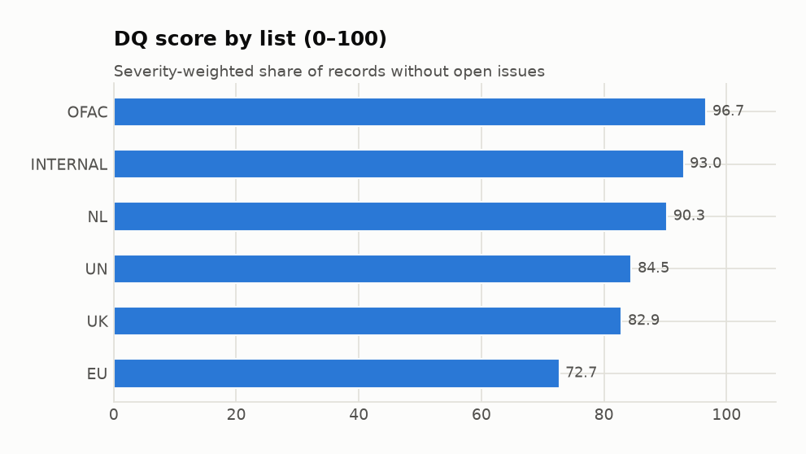
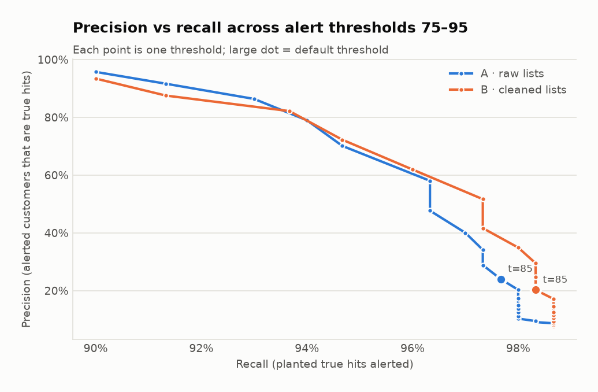
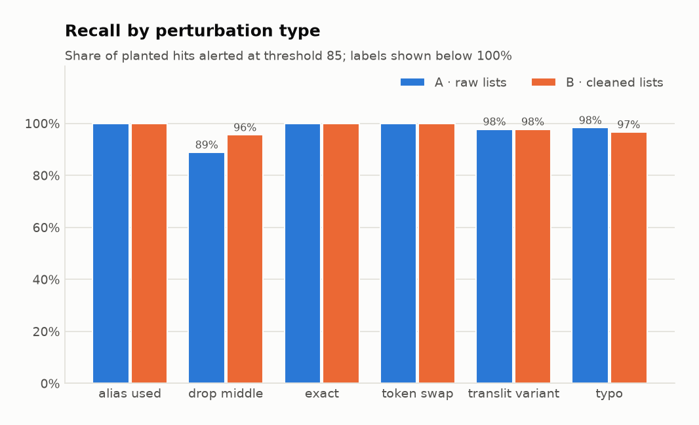
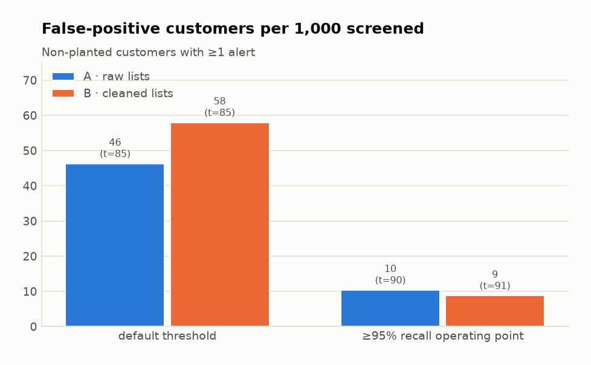

# sanctions-list-ops: run 2026-11-23

**Key findings, live run of 2026-11-23** (generated by `slo report`; every number comes from `summary.json`)

| List | Entities | Published | DQ score | Persons with full DOB | Persons with nationality | Open high-severity entities |
|---|---:|---|---:|---:|---:|---:|
| EU | 6,303 | 2026-11-20 | 72.7 | 72.6% | 60.3% | 909 |
| UN | 1,007 | 2026-11-22 | 84.5 | 56.9% | 85.9% | 56 |
| OFAC | 19,629 | 2026-11-23 | 96.7 | 87.3% | 81.2% | 151 |
| UK | 6,453 | 2026-11-23 | 82.9 | 68.9% | 72.3% | 742 |
| NL | 109 | 2026-11-23 | 90.3 | 100.0% | 0.0% | 0 |

- **Placeholder and partial birth dates are the biggest data gap.** 556 UK, 513 EU and 893 OFAC persons have only a year, month or range (DQ011). The UK publishes these as literal `dd/mm/YYYY` placeholders.
- **Persons with no DOB at all (DQ010):** EU 722, UK 711, UN 53, OFAC 71.
- **Country data:** 1,756 EU country fields use code `00` (UNKNOWN). OFAC/UK have 86 historical or unmappable values (e.g. `Serbia and Montenegro`, `USSR`, birth places with no country).
- **Identifiers:** 17 UK designations repeat the same passport/ID (DQ031). 173 identifiers appear on two different entities in the same list (DQ032, possible duplicates).
- **UN → EU / UK transposition:** 944 of 1,007 UN entities are found on the EU list, 1,006 on the UK list. Only 82 of those EU matches could use a UN reference published on the EU record; the rest were linked by name + DOB. 63 UN entities have no EU match (median 5749 days since UN listing; by UN regime: Iran 20, Guinea-Bissau 10, DPRK 7, ISIL/Al-Qaida 7).
- **Name hygiene fixed automatically:** 2,173 names with whitespace noise, 319 empty alias elements, 2,014 duplicate-name groups (DQ002/DQ004/DQ005, see `fix_log`).

**Screening experiment** (20,000 synthetic customers, 300 planted hits drawn from the lists, threshold 85):

| | Recall | Precision | FP customers / 1k | Alerts | ≥95% recall at |
|---|---:|---:|---:|---:|---|
| A · raw lists | 97.7% | 24.0% | 46.25 | 6,276 | threshold 90 (10.35 FP customers per 1k) |
| B · cleaned lists | 98.3% | 20.3% | 57.95 | 8,328 | threshold 91 (8.75 FP customers per 1k) |

Cleaning changed recall by +0.7% and false-positive customers by +11.7 per 1k at the same threshold. **Trade-off:** the extra recall costs more alerts, because transliterated and normalised names also match more innocent customers. The weakest case after cleaning is `drop_middle` (96% recall): dropping middle names removes most of the evidence a name matcher has. Tuned to the same ≥95% recall target, the raw lists need threshold 90 (10.35 FP customers per 1k) and the cleaned lists threshold 91 (8.75 per 1k). Comparing at one fixed threshold is misleading; list changes should be evaluated together with threshold tuning (below-the-line testing).

